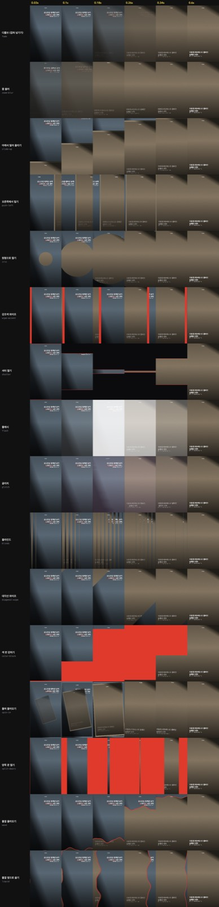
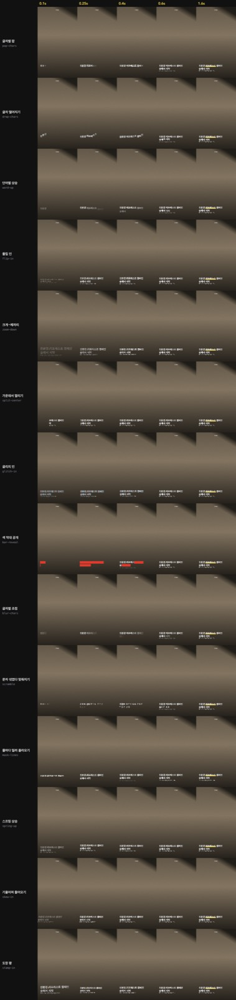
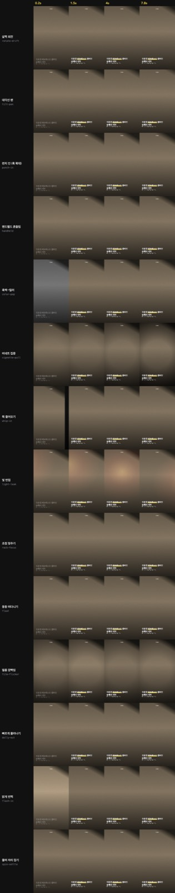
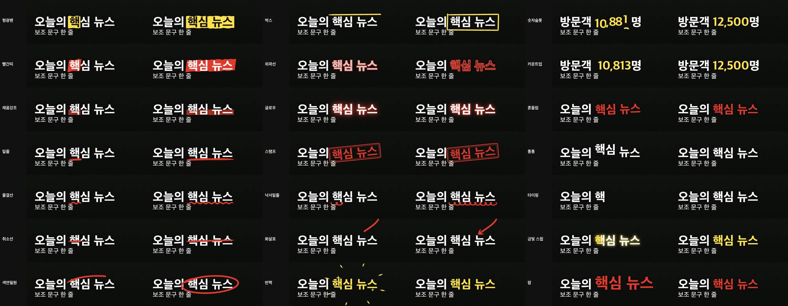
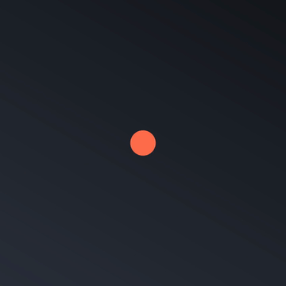

# Cardnews Video Studio

사진·영상·문구로 **1080×1920** 세로 카드뉴스 영상을 만드는 스튜디오입니다.
어드민에서 직접 만들거나, MCP 로 에이전트에게 맡길 수 있습니다.
카드뉴스 틀이 필요 없으면 **Motion Studio MCP** 로 크기·레이어·키프레임을 마음대로 정해 아무 영상이나 만듭니다.

- 한 장 8초, 최대 8장. 인트로·아웃트로 없이 본문만 이어 붙입니다.
- 장이 바뀔 때 앞 장의 마지막 화면과 지금 장이 겹쳐 넘어갑니다.
- 미리보기와 내보내기, MCP 렌더가 같은 엔진(`src/engine/render.ts`)으로 그려서 결과가 똑같습니다.

| | |
|---|---|
| **사이트** | https://cardnews-video-studio.vercel.app |
| **저장소** | https://github.com/minwoo19930301/cardnews-video-studio |

## 모션

장마다 네 가지를 고릅니다. 글자 연출은 앞 1.5초 안에 끝납니다.

| 종류 | 개수 | 예 |
|---|---|---|
| 장 전환 (0.45초) | 16 | 물결, 디졸브, 밀기, 블라인드, 색 판 걷히기, 양쪽 문, 원형, 글리치 |
| 사진·영상 움직임 | 23 | 펀치 인, 초점 맞추기, 핸드헬드, 흑백→컬러, 빛 번짐 |
| 제목 등장 | 24 | 도장 쾅, 스프링 상승, 문자 섞였다 맞춰지기, 줄마다 밀려 올라오기 |
| 부분 강조 | 21 | `==형광펜==` `@@원@@` `;;12,500;;` 카운트업 `(>화살표<)` `[~낙서밑줄~]` |

<table>
  <tr>
    <td></td>
    <td></td>
  </tr>
  <tr>
    <td></td>
    <td></td>
  </tr>
</table>

강조 마커 전체: `==형광펜==` `@@색연필 원@@` `__밑줄__` `[[박스]]` `~~취소선~~` `%%타이핑%%` `##1,234##` `++빨간 띠++` `**글로우**` `::외곽선::` `<<스탬프>>` `!!흔들림!!` `^^통통^^` `≈≈물결≈≈` `{{채움}}` `&&반짝&&` `$$금빛 스윕$$` `||팝||` `;;카운트업;;` `[~낙서밑줄~]` `(>화살표<)`

모션을 만들 때 쓰는 이징·스프링·스태거 도구와 새 모션 추가 방법은 [docs/MOTION-RECIPES.md](docs/MOTION-RECIPES.md) 에 있습니다.

## 배치 · 색 · 로고 · 글씨체

- 제목 묶음과 로고는 미리보기 화면에서 끌어서 옮깁니다.
- 번호 칩은 기본으로 숨기고, 필요할 때만 켭니다.
- 제목 뒤에 가로선 / 글자 뒤 상자 / 아래 전체 띠 / 흐린 유리(띠·상자)를 깔 수 있고, 색과 진하기를 고릅니다.
- 제목·로고를 누르면 모서리로 크기를 바꾸고 × 로 지웁니다. 끌 때는 가운데·여백에 맞춰 안내선이 나옵니다.
- 장마다 글자 / 강조 / 번호 칩 / 형광펜 색과 바탕 어둡기를 고릅니다. 프리셋 7개가 있고 "모든 장에 적용" 으로 한 번에 맞춥니다.
- 로고는 글자나 이미지 둘 다 됩니다.
- 글씨체 33개 (프리텐다드, 지마켓 산스, 노토 산스, 고운돋움, 함렛, 나눔손글씨 등).

## 어드민

```bash
npm install
npm run dev        # http://localhost:5179
```

## MCP

에이전트가 프로젝트 JSON 을 넘기면 MP4 와 확인용 이미지를 만듭니다. `ffmpeg` 가 필요합니다.

```bash
npm install
npm run mcp:build      # 카드뉴스 · Motion Studio 서버를 함께 빌드
```

```json
{
  "mcpServers": {
    "cardnews": {
      "command": "node",
      "args": ["/절대경로/cardnews-video-studio/mcp/dist/server.mjs"]
    }
  }
}
```

| 도구 | 하는 일 |
|---|---|
| `list_motions` | 효과·전환·마커·글씨체·색·이징 목록 |
| `render_video` | 모든 장 또는 한 장을 MP4 로 저장 |
| `render_frame` | 특정 시점 한 프레임을 PNG 로 저장하고 미리보기 반환 |
| `render_contact_sheet` | 여러 시점을 한 장에 모아 모션 타이밍 확인 |

## Motion Studio MCP (자유 모션)

카드뉴스 틀 없이 영상을 만듭니다. 크기·길이·fps 를 정하고 레이어를 쌓습니다.



- **장면 모드:** 글자·이미지·영상·사각형·원·선 레이어에 위치·크기·회전·투명도·흐림·색을 키프레임으로 줍니다. 이징 16종과 스프링, 등장·퇴장 프리셋 17종, 글자·단어·줄 단위 등장이 있습니다. 예시는 [docs/examples/scene.json](docs/examples/scene.json).
- **코드 모드:** 매 프레임 Canvas 2D 코드를 직접 넘깁니다. 이징·스프링·노이즈 도구와 이미지를 함께 씁니다. 예시는 [docs/examples/orbit.js](docs/examples/orbit.js). 로컬 전용이며 보안 샌드박스가 아닙니다.
- **출력:** `.mp4`, `.webm`(투명), `.mov`(ProRes 4444, 투명), `.gif`. 오디오 파일을 넣을 수 있습니다.

```json
{
  "mcpServers": {
    "motion": {
      "command": "node",
      "args": ["/절대경로/cardnews-video-studio/mcp/dist/motion-server.mjs"]
    }
  }
}
```

| 도구 | 하는 일 |
|---|---|
| `motion_reference` | 장면 형식·프리셋·이징·코드 API 와 예시 |
| `render_scene` · `render_code` | 영상 파일로 저장 |
| `render_scene_frame` · `render_code_frame` | 한 프레임 PNG + 미리보기 |
| `render_scene_sheet` | 여러 시점을 한 장에 |

## 터미널

같은 엔진을 터미널에서도 씁니다.

```bash
node mcp/dist/cli.mjs video data/sample.json out/all.mp4
node mcp/dist/cli.mjs gallery data/sample.json out/text.png text
node mcp/dist/cli.mjs scene docs/examples/scene.json out/scene.mp4
node mcp/dist/cli.mjs code docs/examples/orbit.js out/orbit.gif 3 1080x1080
```

Node 렌더는 `public/fonts` 와 시스템 글꼴만 씁니다. 다른 글꼴은 `CARDNEWS_FONT_DIR` 에 파일을 두면 등록됩니다.

## 배포

```bash
npm run build          # dist-admin/
npx vercel --prod
```

## 구조

```
src/engine/    # 카드뉴스 엔진(render), 자유 장면 엔진(scene), 이징·스프링 도구(easing)
src/admin/     # 어드민 UI, 브라우저 인코딩
mcp/           # 카드뉴스 MCP(server), Motion Studio MCP(motion-server), CLI, ffmpeg 도우미
src/video/     # Remotion 구성 (그대로 보존, 새 모션 미반영)
docs/          # 모션 레시피, 갤러리
```
